  

  

  
  
  

---

### Sobre mí
**Ingeniero de Sistemas** *(Mención de Honor, Universidad de la Costa CUC)* con **+4 años de experiencia** construyendo plataformas transaccionales de alta concurrencia, **agentes inteligentes (RAG + Tool Calling)** y **pipelines de datos modernos en la nube (GCP)**.

Opero en la intersección de **Ingeniería de Software, IA Aplicada y Datos**: llevo soluciones desde la arquitectura backend y bases de datos hasta pipelines ELT automatizados y tableros analíticos que impactan directamente el negocio.

| +750 Estaciones | -40% Carga | -50% Deploys | 2.5x Velocidad IA |
| :---: | :---: | :---: | :---: |
| Plataforma transaccional nacional (**Terpel**) | Optimización Full Stack & SQL | CI/CD con **Docker + GitHub Actions** | Flujo **Claude Code / Cursor + Spec-Driven** |

---

### Mis 3 Pilares de Ingeniería

| Ingeniería de Software & Full Stack | Agentes IA & Sistemas RAG | Data Engineering & Analytics |
| :--- | :--- | :--- |
| Plataformas transaccionales y microservicios en **TypeScript, React, Next.js, Node.js, FastAPI, Go y Spring Boot**. | Integración de **OpenAI, Anthropic y Gemini** con flujos agénticos, **Tool Calling** y salidas estructuradas (*JSON Schema*). | Pipelines **ELT** con **Arquitectura Medallion (Bronze, Silver, Gold)** en **GCP (GCS + BigQuery)** y **Parquet**. |
| Arquitecturas orientadas a eventos (**Kafka, WebSockets, Webhooks**), **PostgreSQL / PL-SQL** y observabilidad con **Sentry**. | Pipelines **RAG** completos: chunking semántico, **vector embeddings** y recuperación contextual de alta precisión. | Transformaciones y calidad con **dbt Core** (*data & unit tests*), **SQL analítico**, **Pandas** y **Looker Studio**. |

---

### Experiencia & Proyectos Destacados

#### Ingeniería de Datos & Analítica
- **[ELT Datos Públicos — SECOP II (Medallion Architecture en GCP)](https://github.com/gmartine32/elt-datos-publicos)**
  Pipeline ELT diario en producción con datos reales de contratación estatal (`datos.gov.co`). Extracción incremental en **Python** con paginación determinística (`$order=:id`) y Parquet particionado Hive -> **GCS** -> **BigQuery** idempotente vía *partition decorators* (`$YYYYMMDD` + `WRITE_TRUNCATE`, 0 duplicados) -> **dbt Core** (capas Silver & Gold particionadas/clusterizadas + **32 pruebas automatizadas**) -> **Docker + GitHub Actions** -> **Looker Studio**.

#### Inteligencia Artificial & Productos Propios
- **Papyria — Founder & AI / Full Stack Engineer** *(2024 – 2025)*
  Lector documental multiplataforma impulsado por agentes conversacionales (**OpenAI / Anthropic**). Pipeline **RAG** end-to-end (segmentación semántica, *vector embeddings*, salidas estructuradas), backend en **Python (FastAPI)** + **Node.js** + **PostgreSQL**, *tool calling* y *webhooks* para sincronización en la nube.

#### Ingeniería de Software a Escala (Producción)
- **Devitech S.A.S – Terpel — Senior Full Stack & AI-Accelerated Engineer** *(2021 – Actualidad)*
  Evolución full stack de plataforma transaccional que soporta **+750 estaciones de servicio Terpel** a nivel nacional (**-40% tiempos de carga**, **-50% ciclos de despliegue**). **TypeScript, React, Node.js, PostgreSQL/PL-SQL, Kafka, WebSockets, Docker, GitHub Actions y Sentry**.
- **Populi S.A. / MoviSAI / Consultoría Full Stack** *(2022 – 2025)*
  - **Premios Perrenque:** plataforma completa de postulación y votaciones en **Next.js / React + PostgreSQL**.
  - **ODR Logística:** sistema de ruteo y trazabilidad en **React + Node.js** con **Google Maps / Routes APIs** y webhooks.
  - **MoviSAI (Gob. de San Andrés):** plataforma web/móvil de censo vehicular (**-40% tiempo de registro operativo**).
  - **Beefree & Begima:** microservicio de reportería/analítica en **Node.js** (**-50% tiempo de procesamiento**) y e-commerce en **React** (**+18% conversiones**).

---

### Stack Tecnológico

| Dominio | Herramientas |
| :--- | :--- |
| **Frontend** |       |
| **Backend & Messaging** |       |
| **AI & LLM Engineering** |     |
| **Data Engineering & BI** |         |
| **Cloud, DevOps & Observability** |      |

---

### Actividad en GitHub

  
  

  

  

